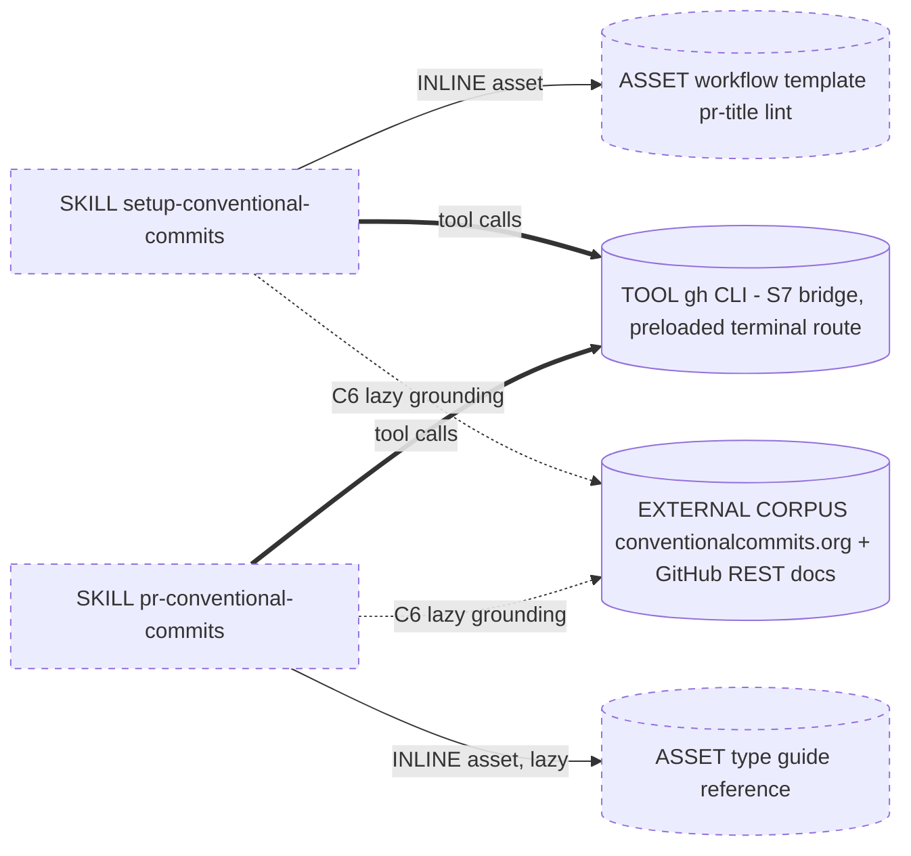
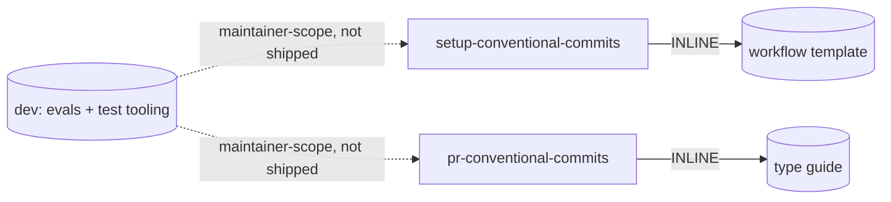

# Handoff Packet: Conventional Commits Agent Skills

Design plan for two agent skills, produced by the `genesis` design
process (steps 1-6). This packet is the source of truth for the
coding step (7a/7b) and for any future refactor. Re-running the
design starts from this packet, not from the emitted skills.

Inputs: `desires-for-conventional-commits-setup.md`,
`setup-guide-for-conventional-commits.md`,
`type-guide-for-conventional-commits.md`,
`conventional-commits-info-links.md`, `skill-testing-repos.md`.

Cost stance: `balanced` (default; operator did not declare).
Cost cap: none declared (projection is informational, not a gate).

---

## Step 1 - Intent + scope

### Skill A: `setup-conventional-commits`

One paragraph: Configure an EXISTING GitHub repository so that the
only path to `main` is a squash-merged PR whose title is a valid
Conventional Commits message. Implements the three-level footprint
from the setup guide: (1) repo merge settings (squash-only, default
squash message = PR title), (2) a `main` ruleset (require PR,
required PR-title status check, block force push / deletion, empty
bypass list), (3) a PR-title lint workflow using
`amannn/action-semantic-pull-request`. No local git tooling (Level
4 = nothing). Boundary: does NOT create the repo, does NOT scaffold
the .NET application, does NOT compose PR titles (that is Skill B).
Nothing in the footprint is .NET-specific; .NET is an indirect
trigger, not a constraint on the skill body.

Constraint handling (from desires): personal accounts; public repos
fully supported; private repos accommodated with a detected,
reported gap (rulesets on private personal repos need GitHub Pro --
skill detects the failure and degrades gracefully, applying Levels
1 and 3 and reporting what is missing).

### Skill B: `pr-conventional-commits`

One paragraph: Create or update a GitHub pull request so its TITLE
is a valid Conventional Commits message, for squash-merge repos
where the PR title becomes the commit message on `main`. Reads the
branch diff and commit history (deterministic tool reads),
classifies the change into the de-facto 10-type set, composes
`type(scope)!: description` plus a body with a `BREAKING CHANGE:`
footer when warranted, applies via `gh pr create` / `gh pr edit`,
and verifies the repo's PR-title check passes (bounded retry).
Preflight: detects whether the repo has been scaffolded for
conventional commits (PR-title lint workflow present; squash merge
enabled). If NOT scaffolded, the skill still composes and applies
the conventional title (it is valuable on its own), skips the
check-polling step, and reports the gap with a recommendation to
run setup-conventional-commits -- it never attempts the scaffold
itself (permission asymmetry: the invoking user is often a
contributor without admin rights). Boundary: does NOT configure
repo settings, rulesets, or workflows (that is Skill A); does NOT
enforce conventional commits on branch commits (per desires,
branches are unconstrained).

### Dispatch descriptions (draft; final wording validated by trigger evals)

Skill A (~640 chars, imperative, intent-first, indirect triggers,
mode BOTH):

> Use this skill when the user wants to set up, scaffold, or
> configure a GitHub repository to use Conventional Commits
> enforced at squash-merge time: squash-only merge settings, a
> main-branch ruleset requiring PRs and a PR-title check, and a
> PR-title lint workflow. Also use when the user asks to "protect
> main", "prevent direct pushes", "enforce commit message format on
> main", or is setting up a new .NET (or any) app repo that should
> keep a clean conventional history. Configures the repo via gh
> CLI. Requires ADMIN access to the target repo. Does NOT create
> the repo or app code, and does NOT write PR titles (see
> pr-conventional-commits).

Skill B (~600 chars, imperative, intent-first, indirect triggers,
mode BOTH):

> Use this skill when creating or updating a GitHub pull request
> whose title must be a Conventional Commits message -- squash-merge
> repos where the PR title becomes the commit on main. Also use
> when a "PR Title" / semantic-pull-request check is failing, when
> the user asks which commit type (feat, fix, chore, ...) a change
> is, or when opening any PR in a repo set up by
> setup-conventional-commits. Composes type(scope)!: description
> titles and BREAKING CHANGE footers from the actual branch diff.
> Works for any contributor who can open a PR. Does NOT configure
> repo settings, rulesets, or workflows (see
> setup-conventional-commits).

---

## Step 2 - Component diagram



All boxes are NEW except the gh CLI (existing preloaded substrate)
and the external corpora. No personas, no rules, no orchestrators:
each skill is a single-lens procedure and a persona would add no
independent lens. Module types: SA, SB = SKILL (MODULE ENTRYPOINT);
WT, TG = ASSET.

## Step 3 - Thread / sequence diagrams

Pattern selection (tier order):

1. Refactor triggers: repo has no existing skill modules; nothing
   to split/fuse/extract/inline. The A/B two-skill split is a
   legitimate R1 (see step 4).
2. Tier 3: **A9 SUPERVISED EXECUTION (weak form)** for both skills.
   Both name consequential side effects on a system of record
   (GitHub repo settings, rulesets, workflow files, PRs) and facts
   that must be true (current settings, repo visibility, plan
   limits, check outcomes). Weak form because both run in an
   interactive session where the operator is the auditor; no
   trigger surface with capability gating is in play. A2 PIPELINE
   also loosely fits Skill A's staged shape, but the A9 selection
   heuristic resolves it: "pick A9 over plain A2 when at least one
   stage is a consequential side effect" -- every stage here is.
   No matrix consult needed (step 3.1 skipped; no genuine tension).
3. Tier 2: S7 DETERMINISTIC TOOL BRIDGE (route 1, preloaded
   terminal + gh CLI), S4 VALIDATION DECORATOR (read-back verify
   after every mutation; PR-title check status as the gate in B),
   B2 CONDITIONAL DISPATCH (Skill B branches on the detected
   scaffold state; Skill A fails fast on missing admin permission),
   B4 PLAN MEMENTO (Skill A writes a setup checklist artifact
   before mutating; reloaded per level), B8 ATTENTION ANCHOR
   (goal + constraints restated at each level boundary), B10 HUMAN
   CHECKPOINT (Skill A: before applying the settings/ruleset diff
   to a real repo, and before overwriting any existing ruleset or
   workflow; Skill B: before editing a PR title the user did not
   author this session), C1 LAZY ASSET (workflow template, type
   guide), C6 EXTERNAL CORPUS GROUNDING (GitHub REST shapes and
   action version verified live at run time, never from recall).
4. Tier 1 idioms: deferred to step 7b.

Single thread each; no spawns; no shared-sink interlocks needed
(one writer: the session itself).

### Skill A thread

```mermaid
sequenceDiagram
    participant U as Operator
    participant S as Session (skill A)
    participant G as GitHub via gh CLI

    S->>G: preflight reads (auth + token scopes, permission level, visibility, plan, settings, rulesets, workflow)
    G-->>S: current state (facts via tool, not recall)
    Note over S: not admin or missing workflow scope -> fail fast with who-to-ask guidance

    S->>S: compute diff current vs target; write checklist (B4)
    S->>U: B10 checkpoint - proposed changes incl. private-plan gap if any
    U-->>S: approve / adjust
    S->>G: Level 1 PATCH merge settings
    G-->>S: read-back verify (S4)
    S->>G: Level 3 commit pr-title workflow to main
    G-->>S: read-back verify (S4)
    S->>G: Level 2 create main ruleset (required check by name)
    G-->>S: read-back verify (S4) via rules/branches/main; empty on free-plan private repo -> report gap
    S->>U: final verification report + residual soft spots
```

Ordering note: Level 3 (workflow file) lands BEFORE Level 2 (the
ruleset that requires a PR), so the workflow can be committed
directly to `main` without being blocked by the ruleset the skill
itself creates. The required status check is added to the ruleset
by name via the REST API (no prior run needed via API -- VERIFIED
2026-07-28 against live GitHub REST docs; see step 5 finding (a)).

### Skill B thread

```mermaid
sequenceDiagram
    participant U as Operator
    participant S as Session (skill B)
    participant G as GitHub via gh CLI

    S->>G: read branch, diff vs default, commits, existing PR
    G-->>S: facts (S7 reads)
    S->>G: scaffold detection (pr-title workflow present? squash enabled?)
    G-->>S: scaffolded yes/no (B2 conditional branch)
    S->>S: classify type/scope/breaking (type guide lazy-loaded if ambiguous)
    S->>U: B10 checkpoint if editing a title not authored this session
    S->>G: gh pr create / gh pr edit
    G-->>S: read-back title (S4)
    alt repo scaffolded
        S->>G: poll PR-title check result
        G-->>S: pass -> done; fail -> read check log, fix title, retry (max 2)
    else not scaffolded
        S->>S: skip check polling; note gap
    end
    S->>U: report title, type rationale, check status or scaffold gap + recommend skill A
```

## Step 3.1 - Tradeoff check

Skipped: pattern selection was unambiguous at every slot (recorded
above). No matrix citation required.

## Step 3.2 - Cost check

No spawns, so no per-spawn role-class binding. Skills execute in
the session model; on common substrate a MODULE ENTRYPOINT carries
no per-element model binding, so OMIT is the justified B12 action
(rule 3(i): the primitive type cannot carry the binding). Work is
implementer-class shaped in both skills.

| Module | Role class | Prefix size | Output volume | Turns | Cost patterns applied |
|---|---|---|---|---|---|
| setup-conventional-commits | implementer (session) | M | S-M | medium (4-10) | B13, B14 at validation, B15 candidate at 7b |
| pr-conventional-commits | implementer (session) | S-M | S | low-medium (3-6) | B13, B14 at validation, B15 candidate at 7b |

- B13 CACHE-AWARE PREFIX: skill bodies contain no timestamps, no
  dynamic facts; all volatile state (settings, plan, checks)
  arrives via tool results in the variable suffix.
- B15 TOOL SUBSET: at 7b, if the harness supports per-skill
  allowed-tools, restrict to terminal + file edit.
- No B12 router / A12 gradient: single-thread, no fan-out; nothing
  to route. Not CLASS-UNIFORM (that anti-pattern needs a multi-
  module graph).
- Stance mandates for `balanced` are satisfied (B13 always; role
  class per slot; B14 thrift at validation).

## Step 3.5 - Composition decisions

| Box | Mode | Rationale |
|---|---|---|
| Skill A body | new module (skill) | unit of distribution; copied standalone into consumer repos |
| Workflow template (pr-title lint YAML) | INLINE asset in A | unique to A; emitted artifact template; agents pattern-match concrete structure |
| Skill B body | new module (skill) | independent distribution + invocation cadence |
| Type guide reference | INLINE asset (lazy) in B | only B consumes it at runtime; loaded on ambiguous classification |
| 10-type list in A's body (optional `types:` pin in workflow) | INLINE duplication in A | deliberate: skills ship standalone; a cross-skill sibling dep would be PHANTOM DEPENDENCY at install time; the list is ~15 stable tokens anchored to the Angular convention -- drift risk negligible vs self-containment win |
| gh CLI | substrate tool (S7 route 1) | preloaded terminal; not a module |
| conventionalcommits.org, GitHub REST docs, action releases | EXTERNAL CORPUS (C6, lazy, bounded) | authoritative for spec text / API shapes / action versions only |
| Evals, test-repo tooling, dev-info docs | maintainer-scope, OUTSIDE distribution boundary | no runtime consumer; shipping them is BUNDLE LEAKAGE + dispatch contamination risk |



External modules required: NONE. Distribution mechanism: raw folder
copy of each skill directory into a consumer repo's skill location
(harness-specific path bound at 7b). No module-system adapter
needed at 7b. Skill B's description names Skill A (and vice versa)
as a companion-module recommendation only -- neither depends on the
other at runtime, so no probe is required.

Repo layout (source tree):

```
skills/
  setup-conventional-commits/   SKILL.md + assets/pr-title-workflow.yml
  pr-conventional-commits/      SKILL.md + references/type-guide.md
dev/
  evals/setup-conventional-commits/evals.json
  evals/pr-conventional-commits/evals.json
  test-repos.md                 (test repo lifecycle procedures)
dev-info/                        (existing planning docs, maintainer-scope)
```

## Step 4 - SoC pass

- Split justification (R1): distinct trigger noun-phrases
  (configure repo vs author PR title), divergent change cadence
  (GitHub settings/ruleset/API surface vs commit-type conventions),
  divergent invocation frequency (once per repo vs every PR). Not
  a PREMATURE SPLIT.
- Dispatch collision, between the two: trigger verbs are disjoint
  (set up / configure / protect vs create / update / title / type).
  Each description names the other as its boundary.
- Dispatch collision, vs installed siblings: the operator's
  environment has a `review` skill ("review a GitHub pull
  request") -- different verb space (review vs create/update); no
  collision. No other conventional-commits-adjacent skill installed.
- No duplication of existing modules: repo currently contains no
  skills.
- S7 audit: every consequential side effect (PATCH settings, commit
  workflow, create ruleset, create/edit PR) and every
  fact-that-must-be-true (settings state, visibility, plan, check
  result) crosses the gh CLI bridge. No LLM-asserted state anywhere
  in the design.

## Step 5 - Compliance check

Classic + PROSE + LLM-physics: no BLOCKER, no HIGH.

Open findings:

- MEDIUM -> RESOLVED (verified 2026-07-28 against live GitHub docs;
  todo #1):
  - (a) CONFIRMED. The ruleset `required_status_checks` rule takes a
    free-text `context` string ("The status check context name that
    must be present on the commit"); no requirement that the check
    exist or have run. No two-phase saga; the sequence diagram
    stands. Documented responses for create-ruleset: 201/404/422/500.
  - (b) REVISED -- there is likely NO plan-limit error to catch.
    Availability: rulesets work on private repos only with GitHub
    Pro/Team/Enterprise; on GitHub Free (personal or org) they are
    public-repo-only. On a below-plan private repo, rulesets can be
    CREATED and viewed but are silently NOT ENFORCED (UI banner:
    "Your rulesets won't be enforced on this private repository
    until you upgrade..."); the create endpoint documents no 403
    plan error. Design change for Skill A's degrade branch:
    (1) detect proactively at preflight -- repo `visibility ==
    private` + owner plan via `GET /user` -> `plan.name` -- and
    surface the gap at the B10 checkpoint; (2) read-back verify
    Level 2 with `GET /repos/{o}/{r}/rules/branches/main`, which
    returns only ACTIVELY ENFORCED rules ("Rules in rulesets with
    'evaluate' or 'disabled' enforcement statuses are not
    returned") -- an empty result after creating an active ruleset
    confirms non-enforcement. Drafting decision for 7b: on a
    detected gap, still create the (non-enforced) ruleset so it
    activates automatically on upgrade or on making the repo
    public, and report it as inactive. Residual: exact POST status
    on a free-plan private personal repo (201 vs 403) is only
    observable live -- confirm in test scenario S2, which already
    covers this path.
- LOW: skill names pending trigger-eval validation; alternatives
  considered: `scaffold-conventional-commits` (A),
  `conventional-commit-pr-title` (B).
- LOW: `amannn/action-semantic-pull-request` pinned at major `v6`
  in the template (pinning-worthy: silent drift would change lint
  behavior). At scaffold time the skill verifies the current major
  via the releases API (C6) and warns if the template lags.

Entrypoint spec compliance (targets for step 8): names match
`[a-z0-9-]` and parent dirs; descriptions < 1024 chars (drafts:
~640 / ~600); bodies budgeted well under 500 lines / 5000 tokens
(A: ~150-250 lines incl. checklist template; B: ~100-180 lines);
overflow (type guide details) already routed to a lazy reference
with an explicit load trigger ("read references/type-guide.md when
the change fits more than one type or none cleanly").

---

## Step 6 - Handoff artifacts

### Interface sketches

**setup-conventional-commits** (SKILL, new, invocation: BOTH)
- Intended user: repo OWNER / ADMIN (in personal accounts: the
  account owner). Preconditions verified at preflight, fail fast
  otherwise: gh authenticated; `admin` permission on the target
  repo; token scopes sufficient to edit settings, create rulesets,
  and commit workflow files (`repo` + `workflow`). On failure the
  skill names the missing permission and who can grant/run it.
- Inputs: target repo (defaults to cwd origin); operator approval
  at the B10 checkpoint; optional flags (pin allowed types, enable
  auto-delete-branches, PR body in squash message).
- Outputs: mutated repo settings + ruleset + committed workflow
  file; a verification report (EXTERNAL, normal prose) listing each
  level's before/after state, any plan-limit gaps, and residual
  soft spots (merge-box hand-edit).
- Process spine: preflight reads -> diff + checklist (B4) -> B10
  checkpoint -> apply+verify Level 1 -> apply+verify Level 3 ->
  apply+verify Level 2 -> report (B5 acceptance re-read of the
  checklist).
- Dependencies: assets/pr-title-workflow.yml (INLINE); gh CLI (S7);
  GitHub REST docs + action releases (C6 lazy).
- Idempotency requirement: re-running on a configured repo produces
  a no-op diff and says so at the checkpoint.

**pr-conventional-commits** (SKILL, new, invocation: BOTH)
- Intended user: any CONTRIBUTOR who can open a PR against the
  repo (push access to a branch, or a fork). Editing the title of
  a PR authored by someone else additionally requires triage or
  better on the repo; the skill detects this and reports rather
  than failing mid-flight.
- Inputs: current branch + working repo; optional existing PR
  number; user intent description if provided.
- Outputs: created/updated PR with conventional title (+ BREAKING
  CHANGE footer in body when warranted); short report of type
  rationale and check status (EXTERNAL, normal prose).
- Process spine: S7 reads (diff, commits, existing PR) -> scaffold
  detection (PR-title workflow present? squash merging enabled?)
  -> classify (body decision rules; lazy type guide on ambiguity)
  -> compose title/body -> B10 checkpoint when rewriting someone
  else's title -> gh pr create/edit -> verify title; IF scaffolded:
  poll check, bounded retry (max 2); ELSE: skip polling, report the
  gap and recommend setup-conventional-commits -> report.
- Dependencies: references/type-guide.md (INLINE lazy); gh CLI
  (S7); conventionalcommits.org spec (C6, only on spec-edge cases).
- Title rules carried in body: imperative description, lowercase
  type from the 10-type set, optional scope, `!` and/or footer for
  breaking, target <= 72 chars.

### Permissions and intended users

Who installs and runs what. This table also goes (condensed) into
each skill's README/body so consumers see it before invoking.

| | setup-conventional-commits | pr-conventional-commits |
|---|---|---|
| Intended user | Repo owner / admin | Any contributor opening PRs |
| GitHub permission on repo | `admin` (settings PATCH, ruleset create, workflow commit to main) | Push to a branch or fork + PR create; `triage`+ only to retitle others' PRs |
| gh token scopes | `repo`, `workflow` | `repo` (default gh auth) |
| Typical install location | Admin's environment; not needed by contributors | Every contributor's environment for the repo |
| Runs how often | Once per repo (idempotent re-runs OK) | Every PR |
| On missing permission | Fail fast BEFORE any mutation; name the gap and who can run it | Degrade: compose title anyway; report what it could not do |

Personal-account note (from desires): in personal accounts the
owner is the only admin, so Skill A's audience is effectively the
account owner. Collaborators on a personal repo have push access
but not admin -- they are Skill B's audience.

### Declared targets

`common-only`. Both skills are designed against the common
substrate; step 7a is expected to confirm no per-harness reach is
needed beyond the adapter binding the skill-folder path and
optional allowed-tools field. First concrete target: the operator's
current harness.

### PER-SPAWN DECLARATION TABLE

No task() spawns in this design. Table empty; audience boundary
reduces to: all emitted reports are EXTERNAL (normal prose), the
B4 checklist is INTERNAL (terse table, no caveman contract needed
since no cross-thread consumer exists).

### HUMAN_RATIONALE (never copied into any spawn brief)

Why two skills and not one: the conjunction test fails immediately
("configure a repo AND title a PR"); frequency asymmetry means the
dispatcher would pay a fat body on every PR for content used once
per repo. Why no panel/fan-out: neither task has independent
lenses; a "security lens / settings lens" split would be
FAN-OUT-IN-NAME-ONLY over one checklist. Why weak-form A9: both
skills run interactively; the operator approves the diff before
mutation; strong-form (buffered outputs, no token) belongs to a
future CI-side variant, out of scope here. Why the type list is
duplicated rather than shared: skills are distributed by folder
copy into arbitrary consumer repos; a shared sibling would either
break on install (missing file) or force always-shipping both
skills together. Why Level 3 before Level 2: the skill must not be
blocked by the ruleset it just created; committing the workflow
first keeps the whole scaffold single-pass. Why B10 sits before
Level 1 (one checkpoint, not three): the three levels are one
reviewable diff; per-level checkpoints would be a CHATTY GATE.
Why B detects the scaffold but never performs it: permission
asymmetry (B's audience is contributors, who usually lack admin)
and boundary discipline (auto-invoking A from B would silently
escalate a title-authoring request into repo administration); the
detection result instead branches B's own behavior (poll the check
vs report the gap) and produces a companion-skill recommendation.

### Development strategy

1. Draft order: Skill A first (Skill B's end-to-end verify needs a
   repo with the PR-title check installed, which A produces).
   Drafting is step 7a/7b of the genesis process: reload this
   packet before drafting each skill.
2. Source of truth for domain content: the four dev-info docs.
   The type guide asset in Skill B is a trimmed copy of
   `type-guide-for-conventional-commits.md` (decision rules +
   per-type one-liners; drop the version-bump narrative).
3. dev-info stays maintainer-scope (outside `skills/`); nothing in
   it ships.
4. Evals live in `dev/evals/` (outside the skill folders) to avoid
   BUNDLE LEAKAGE and dispatch contamination.
5. Each skill is refined against at least one real run in a test
   repo before being called done (step 8 REAL-TASK REFINEMENT).

### Testing strategy

Grounded in `skill-testing-repos.md`; base repo
`bryanknox/k0x-workbench` (READ-ONLY -- never mutated).

- Installation for test: copy `skills/<name>/` into the test
  repo's skill directory (path bound at 7b). Repo-scoped install,
  not user-scoped, so the skill under test cannot leak into other
  sessions.
- Skill A tests need REAL repos (settings + rulesets are
  server-side). Lifecycle: RECREATE per scenario -- clone
  k0x-workbench, `gh repo create bryanknox/k0x-test-cc-<scenario>`
  from it, run the skill, assert via `gh api` read-backs, then
  delete (repo deletion = human checkpoint; needs `delete_repo`
  scope explicitly granted).
  - Scenario S1 fresh public repo: full 3-level happy path.
  - Scenario S2 private repo (free plan): Levels 1+3 applied,
    ruleset gap detected and reported, no crash.
  - Scenario S3 already-configured repo: idempotent no-op.
  - Scenario S4 partially/conflictingly configured repo (e.g.
    merge commits enabled, stray ruleset): correct reconcile diff
    shown at checkpoint.
  - Scenario S5 non-admin invoker (collaborator account or a token
    missing the workflow scope): fails fast BEFORE any mutation,
    names the missing permission and who can run the skill.
    (Needs a second account or a scoped-down token; human admin
    participation.)
- Skill B tests REUSE one scaffolded repo (`k0x-test-cc-pr`) with
  reset between runs (close PRs, delete branches) rather than
  recreate.
  - Scenario P1 single bug-fix branch -> `fix: ...`, check green.
  - Scenario P2 breaking API change -> `feat(scope)!: ...` +
    BREAKING CHANGE footer, check green.
  - Scenario P3 docs-only change -> `docs: ...`.
  - Scenario P4 existing PR with bad title -> title fixed, check
    goes red -> green (exercises the bounded retry loop).
  - Scenario P5 UNSCAFFOLDED repo (fresh clone of the base, Skill A
    never run): conventional title still composed and applied,
    check polling skipped, gap reported with a recommendation to
    run setup-conventional-commits.
  - Integration property: B tested inside a repo scaffolded by A
    (P1-P4); P5 deliberately runs outside one.
- GitHub workflow development (the pr-title.yml template itself)
  is exercised only in test repos, never in this dev repo --
  matching the dev-info guidance that workflow run histories
  should not muddy development repos.
- Human admin participation, named up front: creating/deleting
  repos in the personal account, granting `delete_repo` scope,
  and eyeballing ruleset state in the GitHub UI for S2.
- Reset/recreate helpers start as documented `gh` one-liners in
  `dev/test-repos.md`; promote to `dev/scripts/` only if the rule
  of three fires.

### EVALS PLAN

Content evals (run each prompt with_skill and without_skill; if
outputs are indistinguishable, the skill is not adding value):

- A-CE1: "Set up this repo to use conventional commits with squash
  merges." Expected: all three levels applied in the documented
  order, verification report, residual-soft-spot note. Baseline
  failure modes to beat: missing `edited` trigger on the workflow,
  non-empty bypass list, no read-back verification.
- A-CE2: same prompt on a private free-plan repo. Expected:
  explicit gap report for the ruleset, Levels 1+3 still applied.
- B-CE1: bug-fix branch, "open a PR for this." Expected:
  `fix: <imperative summary>` title; without skill: generic title.
- B-CE2: breaking change branch. Expected: `!` marker + BREAKING
  CHANGE footer; without skill: typically missed.
- B-CE3: "open a PR" in an unscaffolded repo. Expected:
  conventional title applied, explicit note that the repo lacks
  the PR-title check + pointer to setup-conventional-commits;
  without skill: generic title, no gap detection.

Trigger evals: ~20 per skill, 60/40 train/val split; validation
split is the ship gate (>= 0.5 hit rate on should-trigger, < 0.5
on near-miss).

- A should-trigger samples: "scaffold conventional commits in this
  repo"; "make main only accept squash merges"; "protect main so
  the PR title becomes the commit message"; "set up commit lint
  for PR titles"; "configure this new .NET repo for conventional
  commits"; "prevent direct pushes to main"; "add a PR title
  check"; "enforce conventional commits on main".
- A near-miss samples (must NOT trigger): "write a conventional
  commit message for these changes"; "fix the failing PR title
  check on my PR" (Skill B); "set up branch naming conventions";
  "add a CI build workflow for .NET"; "rebase my branch onto
  main"; "review this PR"; "what does the ruleset on main do?";
  "squash my local commits".
- B should-trigger samples: "open a PR with a conventional commit
  title"; "update this PR title to pass the check"; "what type
  should this change be, feat or fix?"; "create the PR -- title
  becomes the squash commit"; "the semantic-pull-request check is
  failing"; "retitle PR 42 to conventional format"; "open a PR for
  this breaking change"; "draft a conventional title for this
  diff".
- B near-miss samples: "set up conventional commits in this repo"
  (Skill A); "write conventional messages for each local commit";
  "review PR 42"; "merge PR 42"; "why did CI fail?" (non-title
  check); "rename my branch"; "generate release notes from
  commits"; "configure squash merging".

### COST PROJECTION

Per-module bands (the CONTRACT; step 8 validates):

| Module | Role class | Prefix | Output | Turns |
|---|---|---|---|---|
| setup-conventional-commits | implementer (session) | M | S-M | medium (4-10) |
| pr-conventional-commits | implementer (session) | S-M | S | low-medium (3-6) |

Workflow-level ranges (the PREDICTION; token pass-through anchor at
implementer-class rates ~$3/$15 per Mtok; on subscription-billed
harnesses this is informational only):

- Skill A run: input 30-90K (bulk cacheable), output 2-8K, turns
  4-10 -> roughly $0.15-0.75 per run at the anchor rate.
- Skill B run: input 10-50K (diff size dominates), output 1-4K,
  turns 3-6 -> roughly $0.05-0.35 per run.

Scenarios: S = B on a single-file fix (~$0.05-0.10). M = A on a
fresh public repo (~$0.15-0.40). L = A on a private, partially
configured repo + B on a large refactor PR in the same session
(input up to ~150K, output ~10K, ~$1-2). No cap declared; L is
informational.

Cited cost patterns: B13 (stable skill bodies, volatile facts in
suffix -- guards INVALIDATOR LEAK), B14 (thrift pass at step 8),
B15 (allowed-tools subset if the harness supports it at 7b). B12 /
A12 / R5 not applicable (single thread, no fan-out) -- recorded so
reviewers know the absence is a decision, not an omission.

Declared stance: `balanced`. Cap check: N/A.

### TODOS

| # | Task | Depends on |
|---|---|---|
| 1 | DONE 2026-07-28 -- Verify the two MEDIUM C6 facts against live GitHub docs (ruleset check-by-name; private-plan error shape). Results in step 5 finding. (a) confirmed; (b) revised: silent non-enforcement, not an error | packet |
| 2 | DONE 2026-07-28 -- Draft `skills/setup-conventional-commits/` (SKILL.md + workflow asset) per interface sketch. 7a confirmed `common-only` (frontmatter = name + description only; B15 allowed-tools OMITTED -- it is per-harness syntax and would break the common-only declaration). Structural lint passed: 288 lines, ASCII, description 642 chars, name = dir. Real-run validation remains todo #6 | 1 |
| 3 | DONE 2026-07-28 -- Draft `skills/pr-conventional-commits/` (SKILL.md + references/type-guide.md) per interface sketch. 7a confirmed `common-only` (frontmatter = name + description only; B15 allowed-tools OMITTED, same rationale as todo #2). Type guide trimmed per dev strategy #2 (decision rules + one-liners + tie-breakers; version-bump narrative dropped). Structural lint passed: SKILL.md 180 lines, reference 65 lines, ASCII, description 645 chars, name = dir. Real-run validation remains todo #7 | packet (parallel with 2) |
| 4 | DONE 2026-07-28 -- Authored `dev/evals/<skill>/evals.json` for both skills + `dev/evals/README.md` (run procedure, ship gate). Content evals per plan (A-CE1/2, B-CE1/2/3) in skill-creator-compatible schema, extended with `setup` (scenario refs S1/S2, P1/P2/P5) and `baseline_failure_modes`; expectations grounded in the drafted SKILL.md bodies and workflow asset (job name, `edited` trigger, @v6 pin). Trigger evals expanded from the plan's 8+8 to 10 should + 10 near-miss per skill, split 60/40 stratified (12 train = 6+6; 8 validation = 4+4); gate encoded in JSON (validation: should >= 0.5, near-miss < 0.5). JSON parse + ASCII lint passed. Execution remains todos #6/#7/#9 | 2, 3 |
| 5 | Write `dev/test-repos.md` (create-from-base, reset, delete procedures; human-checkpoint list) | packet |
| 6 | Step 8 validation, Skill A: lint + evals + real run on scenario S1; capture trace; revise | 2, 4, 5 |
| 7 | Step 8 validation, Skill B: lint + evals + real runs P1-P4 in the S1 repo; capture trace; revise | 3, 4, 6 |
| 8 | Degraded-path test S2 (private repo) + idempotency S3/S4 | 6 |
| 9 | Trigger-eval validation split gate on final descriptions; adjust names/descriptions if it fails | 4, 6, 7 |
