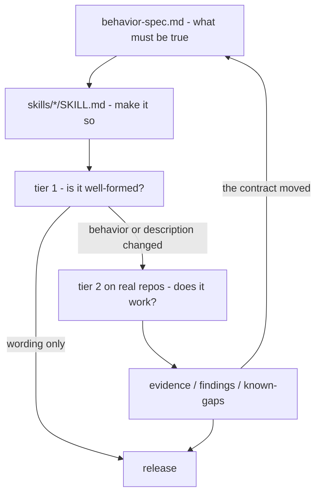

# Contributing

This repository develops, publishes, and supports two agent skills
for enforcing Conventional Commits through pull request titles.

If you want to *use* the skills, you want
[the user documentation](../users/README.md) instead.

## Repository map

| Path | What it holds |
|---|---|
| `skills/` | The skills themselves. The only thing that ships. |
| `.claude/skills/` | Maintainer-only `dev-*` skills. Never ship. See [decision 0014](decisions/0014-dev-skills-outside-skills-dir.md) |
| `.claude-plugin/` | The plugin manifest and the marketplace catalog |
| `CLAUDE.md` | Instructions for Claude Code working in this repo |
| `docs/users/` | Documentation for people using the skills |
| `docs/devs/` | This. Documentation for people changing the skills. |
| `docs/devs/decisions/` | Why things are the way they are |
| `docs/devs/validation-records/` | Archived evidence: what was run against real repositories, and when |
| `tests/` | The structural lint, and the eval definitions |

Nothing outside `skills/` is ever distributed. That boundary is
deliberate and is enforced by review -- see
[decision 0008](decisions/0008-maintainer-material-outside-skill-folders.md).

## The development flow



The part worth internalising is that it is a **cycle**, not a
pipeline. A campaign is not finished when it produces a verdict; it is
finished when the registers and the spec have absorbed what it found.
Several of this repository's sharpest facts arrived that way -- a
predicted failure mode that turned out false, an API that refused
where the documentation said it would silently succeed, a test harness
that was measuring the wrong thing. None of those were visible before
something real was run.

The four cheapest things to get wrong, in order:

- Editing a `description` is a behavior change. It decides which
  prompts invoke the skill, without changing a word of what the skill
  does.
- A green tier 1 says a skill is well-formed. It says nothing about
  whether it works.
- An untested branch and a tested one look identical in the source.
  That is what [known-gaps.md](known-gaps.md) exists to fix.
- An unbumped plugin version leaves installed copies cached, silently.

## Which files for which task

| Task | Read | Run | Then update |
|---|---|---|---|
| Reword a SKILL.md | [authoring.md](authoring.md) | tier 1 | nothing |
| Change a description | [authoring.md](authoring.md) | tier 1, then the trigger evals | [evidence.md](evidence.md) |
| Change behavior | [behavior-spec.md](behavior-spec.md), then [authoring.md](authoring.md) | tier 1, then content evals and a real run | [findings.md](findings.md), [evidence.md](evidence.md), [known-gaps.md](known-gaps.md), and the spec if the contract moved |
| Design a new skill | [design-process.md](design-process.md) | -- | [decisions/](decisions/) |
| Settle a contested choice | [decisions/README.md](decisions/README.md) | -- | a new ADR |
| Check whether something was ever proven | [evidence.md](evidence.md) | -- | -- |
| Find what still needs proving | [known-gaps.md](known-gaps.md) | -- | -- |
| Set up or reset a test repository | [test-repos.md](test-repos.md) | -- | -- |
| Absorb a campaign that produced a verdict | [testing.md](testing.md), "Finishing a campaign" | `dev-absorb-campaign`, then tier 1 | [findings.md](findings.md), [evidence.md](evidence.md), [known-gaps.md](known-gaps.md), and the spec if the contract moved |
| Cut a release | [release.md](release.md) | all four gates | the version in both manifests |

## Start here

**Orientation**

- [The user documentation](../users/README.md) -- you need to know
  what the skills do and how they are used before you can change them.
- [architecture.md](architecture.md) -- what the two skills are, why
  there are two, and where the line between them sits.
- [behavior-spec.md](behavior-spec.md) -- what they must do, as
  numbered requirements everything else cites.

**Doing the work**

- [authoring.md](authoring.md) -- the conventions a `SKILL.md` here
  has to follow, and why each one exists.
- [design-process.md](design-process.md) -- how a new skill gets
  designed before anyone writes prose.
- [testing.md](testing.md) -- the two testing tiers, what each
  catches, and how to run them.
- [test-repos.md](test-repos.md) -- lifecycle procedures for the real
  GitHub repositories the skills are tested against.

**The record**

- [decisions/](decisions/) -- the decisions worth not re-litigating.
- [evidence.md](evidence.md) -- what has actually been run, and the
  independent read-back behind each verdict.
- [findings.md](findings.md) -- what running it found, and what
  changed as a result.
- [known-gaps.md](known-gaps.md) -- what has never been proven.
- [validation-records/](validation-records/) -- archive. The dated
  records the three registers above were harvested from. Read the
  registers first; open a record to check a disputed claim, to see
  what forced an instruction that now looks like ceremony, or before
  repeating a campaign it already covered.

**Shipping**

- [release.md](release.md) -- what "done" means, and how the skills
  reach users.

## Working on a skill

**Use the skills in this repository** without copying anything:

```
claude --plugin-dir .
```

`skills/<name>/SKILL.md` at the repo root is already the layout
Claude Code expects from a plugin, so both skills load as
`conventional-pr-titles:enforce-conventional-commits` and
`conventional-pr-titles:write-pr-title`. Do **not** mirror `skills/`
into `.claude/skills/` -- such a mirror is gitignored precisely so no
second copy can drift from the first.

`.claude/skills/` is not empty, though. It holds the maintainer-only
`dev-*` skills, which are committed and never ship; see
[decision 0014](decisions/0014-dev-skills-outside-skills-dir.md) for
why they cannot live in `skills/`, and "Maintainer-only dev skills"
in [CLAUDE.md](../../CLAUDE.md) for the rules that keep them there.

This loads the working tree, not an installed copy, which is what
you want while editing. It is the same plugin users install from
`.claude-plugin/`; see [release.md](release.md) for how a change
here becomes a release.

**Editing a skill** means editing `skills/<name>/SKILL.md` and
whatever it carries alongside it. Read [authoring.md](authoring.md)
first; several of the conventions there are load-bearing rather than
cosmetic.

**Before opening a pull request**, run the tier 1 checks:

```
bash tests/lint-skills.sh
bash tests/lint-skills.sh .claude/skills 'dev-*'
bash tests/check-links.sh
bash tests/check-workflow-template.sh
bash tests/check-plugin-manifests.sh
bash tests/check-requirement-ids.sh
bash tests/check-skill-inventory.sh
```

CI runs the same seven. See [testing.md](testing.md) for what each
one covers and its one prerequisite.

**Driving any of this from a Claude Code session** is covered next
to the procedure it applies to, rather than on a page of its own:
tier 1 and both kinds of eval in [testing.md](testing.md), the
release in [release.md](release.md), the test repositories and their
human checkpoints in [test-repos.md](test-repos.md), and editing a
`SKILL.md` in [authoring.md](authoring.md). Each says what to hand a
session, what to keep, and the mistake a session makes at that step.

**Changing behavior** -- as opposed to wording -- means the change
needs a real run against a real GitHub repository before it is
believable. Repository settings, rulesets, and status checks are
server-side state that cannot be faked locally. The procedures are
in [test-repos.md](test-repos.md), and the two testing tiers are
explained in [testing.md](testing.md).

## Commit and pull request titles

This repository follows its own convention: the pull request title
is a Conventional Commits message, and it becomes the commit on
`main` at squash-merge time. See
[the user guide](../users/conventional-commits-guide.md) for the
format.

`enforce-conventional-commits` has been run against this repository.
Merge is squash-only with the PR title as the commit subject, and
[`pr-title.yml`](../../.github/workflows/pr-title.yml) validates
that title on every pull request.

The branch ruleset that would make the check *required* could not
be created: ruleset endpoints are plan-gated on a private
free-plan repository. So the check is advisory, direct pushes to
`main` are still possible, and using PRs here is a choice rather
than enforcement.

With `claude --plugin-dir .`, the repository's own
`write-pr-title` will title a pull request here -- the skill applied
to the repository that develops it. Worth doing, with one caveat
that follows from the paragraph above: because the check is
advisory, a red one blocks nothing. Nobody is stopped by a bad
title here, so somebody has to look.

## Checking an enforced repository

Whether a repository that `enforce-conventional-commits` once
configured is still configured. All four reads are read-only and
need no admin rights, and they are the endpoints the skill itself
verifies through -- so this runbook cannot drift from what the skill
checks.

| Read | Proves |
|---|---|
| `gh api repos/{owner}/{repo}` | Level 1: `allow_squash_merge` true, the other two false, `squash_merge_commit_title=PR_TITLE` |
| `gh api repos/{owner}/{repo}/contents/.github/workflows/pr-title.yml` | Level 3: the workflow is there. 404 means absent |
| `gh api repos/{owner}/{repo}/rulesets` | the ruleset object exists |
| `gh api repos/{owner}/{repo}/rules/branches/{default_branch}` | Level 2: it is actually *enforced* |

Run them as separate commands rather than `&&`-chained or under
`set -e`. `gh api` exits non-zero on outcomes that are expected here
-- a 404 for an absent workflow, a 403 for a plan gate -- and
chaining throws away the reads that come after the first one.

**Why the last two rows are both there.** The `rulesets` endpoint
answers whether the object exists. The effective-rules endpoint
returns only rules that are actively enforced, which is a different
question. An empty result from the second after a successful create
means the ruleset exists and is doing nothing -- the failure this
pair is here to separate, and the only one of the three levels that
can be present and inert at the same time.

**Worked example, this repository**, read back 2026-09-19. Level 1
and Level 3 are clean: squash-only, `squash_merge_commit_title` is
`PR_TITLE`, and `pr-title.yml` is present. Two settings differ from
the skill's defaults, deliberately:
`squash_merge_commit_message` is `PR_BODY` rather than `BLANK`, and
`delete_branch_on_merge` is on. The skill offers both on request, so
neither is drift.

Level 2 cannot be read at all. *Both* ruleset endpoints answer
`403 Upgrade to GitHub Pro or make this repository public`, not
just the listing one, so on a free-plan private repository the
exists-versus-enforced distinction above is not observable -- there
is nothing to be ambiguous about, because no ruleset could be
created. That is the expected reading here rather than a
regression; see
[decision 0009](decisions/0009-stay-private-for-now.md).

When a read-back disagrees with what you expect, re-running
`enforce-conventional-commits` is the fix -- it is idempotent, and
a second run on a configured repository declares a no-op rather
than reapplying. It needs admin. `write-pr-title` will not do it
for you even though it detects the same gaps, which is
[decision 0004](decisions/0004-skill-b-never-scaffolds.md).

Doing this by hand is what the deferred verify path in
[release.md](release.md)'s "Notes for later" would replace.
