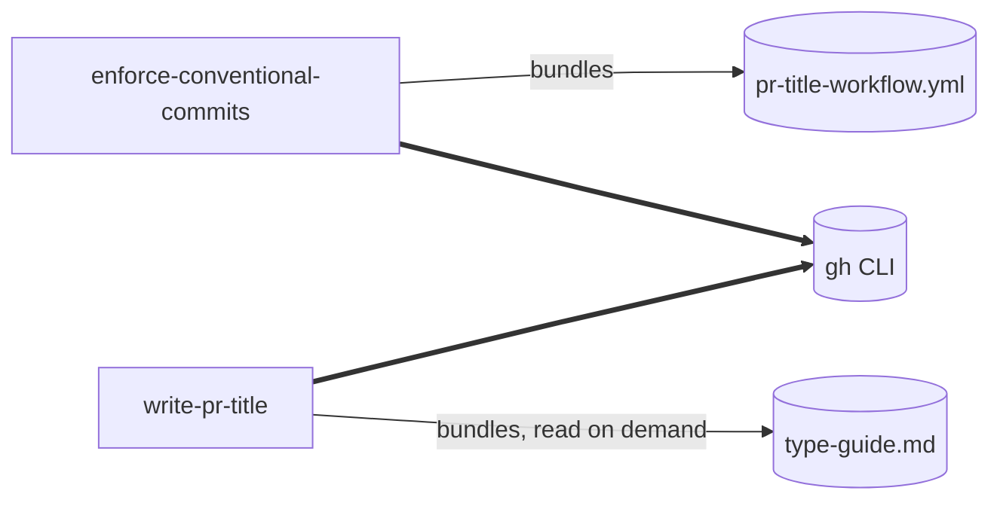

# Architecture

Two skills, one job between them: make every commit on a
repository's default branch a valid Conventional Commits message,
without putting any tooling in anyone's local clone.

## The shape

`enforce-conventional-commits` configures a repository. It runs once,
needs admin rights, and carries the workflow file it installs.

`write-pr-title` writes a pull request title. It runs on
every pull request, needs only push access, and carries a type
decision guide it reads when a change is ambiguous.

Both reach GitHub exclusively through the `gh` CLI. Neither depends
on the other at runtime.

## Why two skills and not one

Three independent reasons, any one of which would be sufficient:

- **The trigger phrases do not overlap.** "Configure a repository"
  and "title a pull request" share no verbs. A single skill would
  need a description covering both, which is a description that
  matches neither well.
- **They change for different reasons.** One tracks GitHub's
  settings, rulesets, and REST API. The other tracks commit-type
  conventions. Those move on unrelated schedules.
- **They run at wildly different frequencies.** Once per repository
  versus once per pull request. Merging them means every pull
  request pays the context cost of repository-administration
  content it will never use.

Recorded as [decision 0002](decisions/0002-two-skills-not-one.md).

## Where the line sits

Each skill names the other in its description as a boundary, and
refuses to cross it:

- Skill A does not compose pull request titles.
- Skill B does not configure repositories -- **even when it detects
  the configuration is missing.** It reports the gap and recommends
  Skill A. See
  [decision 0004](decisions/0004-skill-b-never-scaffolds.md).

That second boundary is the one most likely to get eroded by a
well-meaning change, because auto-fixing looks helpful. It is not:
Skill B's audience is contributors who usually lack admin rights,
so the "helpful" path fails for most users and silently escalates a
title request into repository administration for the rest.

## The three levels

Skill A's whole footprint, in the order it applies them:

1. **Merge settings** -- squash only; squash message is the PR
   title.
2. **The PR-title workflow** -- `.github/workflows/pr-title.yml`.
3. **A default-branch ruleset** -- require a pull request, require
   the title check, empty bypass list.

Level 3 lands before Level 2 deliberately: once the ruleset requires
pull requests, committing the workflow directly to the default
branch would be blocked by the ruleset the skill just created. See
[decision 0006](decisions/0006-apply-order-workflow-before-ruleset.md).

There is no Level 4. No hooks, no commit-message tooling, nothing
installed locally. Its absence is a decision, not an omission --
[decision 0003](decisions/0003-enforce-only-at-the-pr-title.md).

## Two rules both skills obey

These are the properties that make the skills trustworthy, and the
easiest things to break by accident.

**Every fact comes from a tool read.** Never from memory, never from
earlier in the conversation. The repository's merge settings, its
plan, whether a workflow exists, whether a check passed -- all of it
is read from `gh` at the moment it is needed. A skill that asserts
state it did not just read will eventually assert something false.

**Every mutation is read back.** After patching settings, after
committing the workflow, after creating the ruleset: read it back
from GitHub and confirm. The API accepting a request is not evidence
that the intended thing happened.

## Process spines

**Skill A:** preflight reads -> compute the diff and write a
checklist -> one approval checkpoint -> apply and verify Level 1 ->
apply and verify Level 3 -> apply and verify Level 2 -> report.

Two properties matter. It **fails before mutating** if permissions
are insufficient. And re-running on a configured repository produces
a no-op: the diff comes back empty, it says so, and it changes
nothing.

There is exactly one approval, not one per level, because the three
levels are one reviewable change --
[decision 0007](decisions/0007-one-approval-not-three.md).

**Skill B:** read the branch diff and any existing pull request ->
detect whether the repository has the setup -> classify the change
from the diff -> compose title and body -> approval checkpoint *only*
when retitling someone else's work -> create or edit -> verify ->
poll the title check if it exists, with at most two retries ->
report.

Classification comes from the **diff**, not the branch's commit
messages. Those are hints; the diff is the evidence.

## Distribution

Each skill folder is self-contained and copied whole. Nothing
references anything outside its own directory, and neither skill
imports from the other.

This is why the ten-type list appears in both skills rather than
living in a shared file: a shared sibling would either break when a
user installs one skill without the other, or force them to always
be installed together. The list is short and anchored to a
convention that does not move --
[decision 0005](decisions/0005-duplicate-the-type-list.md).
