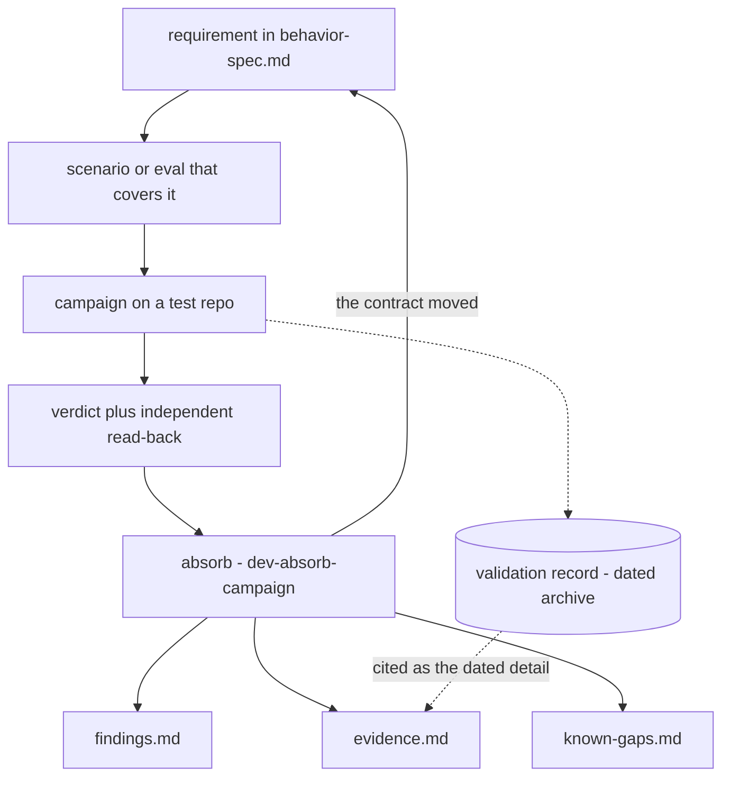

# Concepts and terminology

**What this is for:** the vocabulary the rest of these pages assume.
*Campaign*, *register*, *read-back*, *gate*, and ids like A-F5 or S2
are used everywhere and defined nowhere else.

**Read it** once, when the other pages start to feel like jargon.
After that, go to the page each term links to -- this one defines,
the owning page explains.

**Write to it** when a document starts using a new term of art, or
when a definition here stops matching the page that owns it. The
owning page wins.

## The model in one paragraph

Two skills: **Skill A** (`enforce-conventional-commits`) configures a
GitHub repository once; **Skill B** (`write-pr-title`) titles a pull
request every time. What they must do is written as numbered
requirements in [behavior-spec.md](behavior-spec.md), and each
`SKILL.md` is the instruction set that achieves them. **Tier 1**
checks prove a skill is well-formed; **tier 2** evals, run against
real GitHub repositories, prove it works. A tier-2 run is not done
when it produces a verdict: what it found is written into three
maintained **registers**, and the spec moves if the contract did.

## How evidence flows

The [development flow](README.md#the-development-flow) is the cycle
of editing a skill. This is the narrower path a single piece of
evidence takes, from a requirement to the registers.

Absorbing is the step that gets skipped, because nothing breaks when
it is. A verdict nobody wrote into the registers is a verdict the next
maintainer pays for again. The procedure is in
[testing.md](testing.md#finishing-a-campaign).

## Terms

### Evidence and records

| Term | Meaning | Owned by |
|---|---|---|
| campaign | One tier-2 effort against real repositories: a set of scenarios or an eval split, run to answer one question. The S2, S3, S4 and P5 runs were one campaign; the 2026-09-19 rename gate was another. | [testing.md](testing.md) |
| verdict | What a campaign concluded for each run: PASS, a pass count such as 15/16, or a baseline delta. | [evidence.md](evidence.md) |
| independent read-back | The dev session re-reading server state itself, rather than trusting the runner's report of its own work. The runner is the thing under test, so its account cannot be the evidence. Must be real command output. | [evidence.md](evidence.md), "Runs" |
| absorb | Fanning a campaign's result into the three registers and, if needed, the spec. Done by hand or with `dev-absorb-campaign`. | [testing.md](testing.md#finishing-a-campaign) |
| register | One of three maintained documents keyed by requirement id: [evidence.md](evidence.md) (what has been run), [findings.md](findings.md) (what running it found), [known-gaps.md](known-gaps.md) (what has never been proven). `behavior-spec.md` is the contract, not a register; `next-steps.md` is a pointer list, not a register. | each register's own header |
| validation record | A dated write-up of a campaign, preserved verbatim as evidence. Not maintained, not instructions, not a to-do list. The registers were harvested from these. | [validation-records/](validation-records/README.md) |
| PROVEN / PARTIAL / NOT PROVEN | A requirement's status in `evidence.md`. PARTIAL and NOT PROVEN always link to `known-gaps.md`. | [evidence.md](evidence.md) |
| finding | Something a real run found: a defect, friction, ceremony, a gap in stated behavior, or a thrift issue. Numbered per skill and never renumbered. | [findings.md](findings.md) |
| gap | Behavior nothing has ever exercised. The opposite of a finding: a finding is something a run found wrong; a gap is something no run has looked at. | [known-gaps.md](known-gaps.md) |
| falsified prediction | An eval's expected baseline failure that did not happen. Recorded, never deleted, because it is a result. | [evidence.md](evidence.md), "Runs" |

### Testing

| Term | Meaning | Owned by |
|---|---|---|
| tier 1 | The seven free, deterministic checks CI runs. Proves a skill is well-formed, not that it works. | [testing.md](testing.md) |
| tier 2 | Content and trigger evals. Costs model calls, needs real repositories and a human. Run when behavior or a description changes. | [testing.md](testing.md) |
| content eval | Does the skill do the right thing? Run once with the skill and once without, in fresh sessions, and grade both against the eval's expectations. | [testing.md](testing.md) |
| baseline | The without-skill half of a content eval. A skill indistinguishable from its baseline is a finding, not a pass. | [testing.md](testing.md) |
| trigger eval | Does the skill run at the right time? Prompts are shown to fresh sessions and scored on whether the skill was invoked. | [testing.md](testing.md) |
| dispatch | The model deciding to invoke a skill. The **dispatch surface** is what that decision reads: the name and description, and which other skills are installed alongside. | [authoring.md](authoring.md) |
| near miss | A prompt that should not invoke the skill. One that dispatches to the sibling skill instead is a pass. | [testing.md](testing.md) |
| train / validation | The two splits of the trigger prompts. Iterate the description against `train`; score `validation` only once the wording is frozen. | [testing.md](testing.md) |
| gate | A pass threshold that must be met before shipping. The trigger gate is scored on the `validation` split. | [testing.md](testing.md) |
| containment | Restricting a trigger-eval session to `Skill` and read-only tools with `--tools`. Without it the harness under-measures dispatch (T-F3). | [testing.md](testing.md) |
| test repo | A real, disposable GitHub repository created from the read-only **base repo** to run a scenario in. | [test-repos.md](test-repos.md) |
| scenario | A named repository setup plus a run, such as S2 (private free-plan repo) or P4 (existing PR with a bad title). Each lists the requirements it covers. | [test-repos.md](test-repos.md) |
| human checkpoint | A step only the operator can take -- creating or deleting a repository, switching accounts, answering a skill's approval gate. | [test-repos.md](test-repos.md) |

### Skill behavior

| Term | Meaning | Owned by |
|---|---|---|
| Level 1 / 2 / 3 | Skill A's footprint. Level 1: merge settings. Level 2: the default-branch ruleset. Level 3: the PR-title workflow. Applied in the order 1, 3, 2, so the workflow is committed before the ruleset would block the commit. | `skills/enforce-conventional-commits/SKILL.md`; [architecture.md](architecture.md) |
| preflight | Skill A's opening reads: permissions, plan, and current state, all taken before anything changes. | [architecture.md](architecture.md), "Process spines" |
| fail before mutating | A failure lands before any change or after all of them, never partway through. A missing permission is caught in preflight. | [behavior-spec.md](behavior-spec.md), INV3 |
| one approval | A single checkpoint covering the whole change, never one per level. | [behavior-spec.md](behavior-spec.md), INV4; [decision 0007](decisions/0007-one-approval-not-three.md) |
| degrade | Do what remains possible, then report exactly what did not happen and what would unblock it. | [behavior-spec.md](behavior-spec.md), INV5 |
| plan gate | GitHub refusing every ruleset endpoint with HTTP 403 on a free-plan private repository, so Level 2 cannot exist there. | [findings.md](findings.md), A-F5 |
| no-op | A second Skill A run on a configured repository: the diff is empty, it says so, and nothing changes. | [architecture.md](architecture.md), "Process spines" |

### Repository structure

| Term | Meaning | Owned by |
|---|---|---|
| shipped skill | A skill in `skills/`. Everything there reaches every installer. | [CLAUDE.md](../../CLAUDE.md) |
| dev skill | A maintainer-only skill in `.claude/skills/`, named `dev-*`. Never ships. | [decision 0014](decisions/0014-dev-skills-outside-skills-dir.md) |
| decision | A numbered record of a settled choice, in [decisions/](decisions/README.md). Cited as "decision 0009". | [decisions/](decisions/README.md) |

## Id schemes

| Id | Names | Defined in | Example |
|---|---|---|---|
| `INV*` | Invariants both skills obey | [behavior-spec.md](behavior-spec.md) | INV3 |
| `A-R*`, `B-R*` | Skill A and Skill B requirements | [behavior-spec.md](behavior-spec.md) | A-R11 |
| `A-F*`, `B-F*` | Findings against Skill A and Skill B. Validation records use bare `F1`, `F2`. | [findings.md](findings.md) | A-F5 |
| `T-F*` | Findings against the test procedures or the eval harness | [findings.md](findings.md) | T-F3 |
| `S1`-`S5` | Skill A scenarios | [test-repos.md](test-repos.md) | S5 |
| `P1`-`P5` | Skill B scenarios | [test-repos.md](test-repos.md) | P4 |
| `A-CE*`, `B-CE*` | Content evals | `tests/evals/<skill>/evals.json` | A-CE2 |
| `A-T*`, `B-T*` | Trigger prompts that should invoke the skill | `tests/evals/<skill>/evals.json` | B-T3 |
| `A-N*`, `B-N*` | Near-miss trigger prompts | `tests/evals/<skill>/evals.json` | A-N9 |
| `0001`-`0014` | Decisions | [decisions/](decisions/README.md) | 0013 |

Requirement ids are stable: a retired one is marked withdrawn rather
than renumbered. `tests/check-requirement-ids.sh` fails if a citation
in the registers, `test-repos.md`, or the eval files stops resolving,
or if a requirement exists that `evidence.md` says nothing about.
